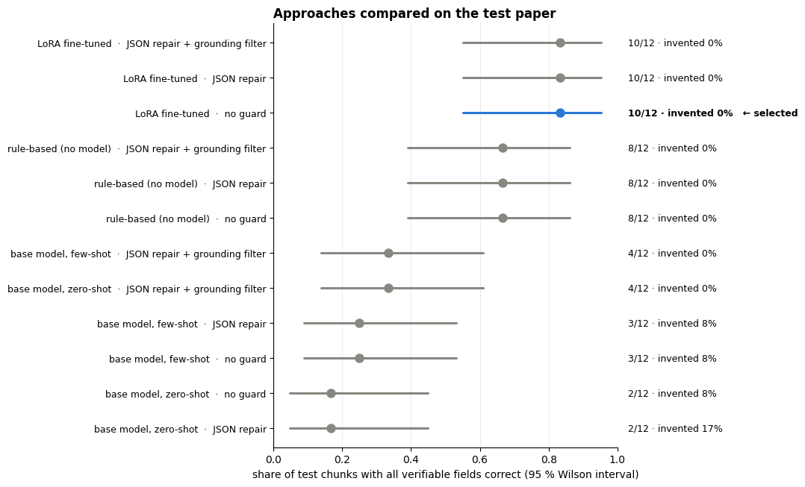

# Folio

Parses academic PDFs (two columns, tables, equations, footnotes), rebuilds their structure and
splits them into chunks for retrieval. A second package fine-tunes a small language model with
LoRA to extract JSON metadata from those chunks.

Reference run on five arXiv papers: 102 pages, 356 chunks, 97.6K tokens, no failed document.

| Brief | Where |
|---|---|
| Step 1: parsing, library choice, layout analysis | [Parsing](#parsing), [`pdf_layout_extraction.py`](pdf_chunking/pdf_layout_extraction.py) |
| Step 2: chunking strategy, JSON/CSV export | [Chunking](#chunking), [`chunking_strategies.py`](pdf_chunking/chunking_strategies.py), [`results.json`](results.json) |
| Step 3: CLI, documentation, error handling | [Usage](#usage), [`process_pdfs.py`](process_pdfs.py) |
| Stretch: LoRA metadata extraction | [Metadata extraction](#metadata-extraction-with-lora), [`metadata_extraction/`](metadata_extraction) |

## Usage

Python 3.10 or later.

```bash
pip install -r requirements.txt
```

```bash
python scripts/download_arxiv_papers.py
```

```bash
python process_pdfs.py --input ./data --output ./results.json
```

The code is also installable without a checkout, which adds the commands `process-pdfs` and
`download-arxiv-papers`:

```bash
pip install "folio[all] @ git+https://github.com/heimerdingerUltra/Folio.git"
```

| Output | Content |
|---|---|
| `results.json` | chunk dataset (`.jsonl` or `.csv` by changing the extension) |
| `results.run_report.json` | configuration, timings, distributions, quality metrics, errors |
| `results.dashboard.html` | the same report as a page |

| Option | Default | |
|---|---|---|
| `--strategy` | `structure` | or `fixed`, the fixed-size baseline |
| `--max-tokens`, `--overlap-tokens`, `--min-tokens` | 400, 50, 40 | chunk budget, sentence-aligned overlap, merge threshold |
| `--pdf-parser` | `pymupdf` | or `opendataloader` (needs Java 11+) |
| `--table-detection` | `auto` | `layout` (ONNX model, about 1 page/s), `heuristic` (fast), `off` |
| `--benchmark-against-fixed-windows` | off | also score and export the baseline |

Exit codes: `0` every document processed, `1` some failed and the others were exported, `2` nothing
exported. A missing, empty, corrupted, encrypted or scanned file is recorded in the report with
its error and the batch continues.

One exported chunk:

```json
{
  "chunk_id": "attention_is_all_you_need-0008",
  "source_document": "Attention_Is_All_You_Need.pdf",
  "document_title": "Attention Is All You Need",
  "page_number": 4,
  "page_end": 4,
  "section": "3 Model Architecture > 3.2 Attention > 3.2.1 Scaled Dot-Product Attention",
  "content_type": "text",
  "chunk_index": 8,
  "token_count": 314,
  "char_count": 1529,
  "chunk_text": "3.2.1 Scaled Dot-Product Attention\n\nWe call our particular attention ...",
  "embedding_text": "Attention Is All You Need - 3 Model Architecture > ...\n\n3.2.1 Scaled ..."
}
```

`embedding_text` is the text to index (title, section, then the chunk). `content_type` is `text`,
`table` or `references`, so a retriever can leave the bibliography out.

The pipeline is a chain of stages ([`command_line.py`](pdf_chunking/command_line.py)):

```python
ChunkingPipeline(config)
    .discover_pdfs()
    .extract_documents()
    .chunk_documents()
    .validate_chunks()
    .measure_chunk_quality()
    .benchmark_against_fixed_windows()
    .export_chunk_dataset()
    .write_run_report()
    .render_performance_dashboard()
```

Other commands:

```bash
python scripts/benchmark_retrieval.py
```

```bash
python scripts/benchmark_pdf_parsers.py
```

```bash
python scripts/benchmark_opendataloader_against_pipeline.py
```

```bash
python -m pdf_chunking.dataset_validation_cli results.json --max-tokens 400
```

Scanned pages, figures and document structure (see [Document engine](#document-engine)):

```bash
python process_pdfs.py --input ./data --output ./results.json --export-structure --workers 4
```

```bash
python scripts/download_arxiv_papers.py --training-corpus
```

```bash
python scripts/evaluate_document_metadata.py
```

```bash
python -m pytest tests -q
```

### Continuous integration

[`.github/workflows/ci.yml`](.github/workflows/ci.yml) runs on every push and pull request:

1. the tests, on Python 3.10 and 3.12;
2. the build of the wheel and the source distribution, checked with `twine`, then installed in a
   clean environment where the `process-pdfs` command is run;
3. the upload of both files as the `dist` artifact of the run.

A tag `vX.Y.Z` equal to the package version also publishes them as a GitHub release:

```bash
git tag v1.1.0 && git push origin v1.1.0
```

## Parsing

A PDF stores text as positioned glyphs. Chunking by structure needs to know what each piece of
text is (heading, paragraph, table, caption), and that has to be inferred from geometry and
typography. PyMuPDF gives access to both (spans with bounding box, font and size) and is fast.

| Parser, default extraction, 102 pages | Time | Ligatures left | Words cut by a hyphen | Two-column probes read in order |
|---|---:|---:|---:|:---:|
| PyMuPDF | 1.1 s | 453 | 608 | 4/4 |
| pypdf | 13.8 s | 453 | 607 | 4/4 |
| pdfplumber | 37.5 s | 0 | 489 | 1/4 |
| This pipeline, without the table model | 2.0 s | 0 | 61 | 4/4 |

pdfplumber reads across the page and interleaves the two columns. Vision-based parsers (Marker,
Docling, Nougat) handle equations better but need a GPU or minutes per document; they were not
evaluated.

What [`pdf_layout_extraction.py`](pdf_chunking/pdf_layout_extraction.py) adds to the library:

| | PyMuPDF alone | Added | On the five papers |
|---|---|---|---|
| Two columns | content-stream order, not guaranteed | geometric reading order | 24 two-column pages |
| Section headings | none | typography, numbering, PDF outline | 143 headings; all 102 outline entries found |
| Tables | `find_tables()` | region from the finder, grid rebuilt from word positions | 56 tables |
| Page numbers, running headers, watermark | plain text | removed | 73 blocks |
| Text inside figures | many 1 to 3 word blocks | removed (band above each figure caption) | 274 blocks |
| Footnotes | break the paragraph above | isolated; the paragraph is joined again | 39 |
| Hyphenation, ligatures | `applica-` / `tions`, `fi` | rule based on the document vocabulary | 608 to 61 cuts, 453 to 0 ligatures |

### Limits

Tables are the weak point.

* The line-based `find_tables()` fails on tables without vertical rules (`booktabs`), which is the
  norm in papers. On ChunkNorris it returned four tables, all of them bar charts, and none of the
  twelve real ones.
* Detection works with the optional `pymupdf-layout` ONNX model. `find_tables()` uses it without
  notice when it is installed, so the same code gives different output on two machines. The
  backend is therefore an explicit option (`--table-detection`) and is written in the run report.
* The model is slow: about 1 s per page, 36 s for one figure-heavy page. Running it only on pages
  with table signals gives the same output 1.3 to 1.7 times faster (two A/B runs).
* The cell text of `Table.extract()` is unusable on these files (`'ComplexityperLayer'`,
  `'660\n.'`), hence the rebuild from word positions. After the rebuild, multi-row cells are still
  separate rows, tight numeric columns can merge, side-by-side tables merge, and exponents are
  flattened (`10²⁰` becomes `1020`).

Equations are linearised: `softmax(QKᵀ/√dₖ)V` becomes `softmax(QKT √dk )V`. The pipeline only
keeps an equation on one line and attached to the sentence that introduces it.

Author blocks set in several columns come out in mixed order: the 45 author names are intact, the
pairing with affiliations is lost.

As a dependency, PyMuPDF is fast and well documented, but untyped (`dict[str, Any]`), uses
bit-mask flags, prints C-library errors to stderr, and is licensed under AGPL-3.0 or a commercial
licence. Only one module imports it.

### Document engine

Three additions on top of the text-layer path. None of them changes the reference chunk dataset.

**OCR.** A page without a text layer is rendered at 200 dpi and read by RapidOCR (ONNX models, CPU,
installed with `pip install "folio[ocr]"`). The recognised lines are grouped into the same typed
blocks as the text-layer path, so reading order, header removal, heading detection and chunking
run unchanged. `--ocr auto` (default) reads only pages without text, `force` reads every page,
`off` restores the previous behaviour (the PDF is reported as scanned).

Check: the first six pages of *Attention Is All You Need*, converted to images, then read back
and compared with the text layer of the original.

| | Scanned copy, OCR | Original, text layer |
|---|---:|---:|
| Words recovered (recall / precision) | 97.0% / 98.9% | reference |
| Title | correct | correct |
| Section headings found | 12 | 13 |
| Time per page (CPU) | 8.6 s | 0.02 s |

OCR gives no font: the size is estimated from the line height and bold is unknown, so headings
on scanned pages rely on numbering and well-known names. Displayed equations and footnotes are
read as plain paragraphs, and the table model is not run on those pages. One document, six pages:
this is a check that the path works, not a benchmark of the OCR model.

**Figures.** A PDF has no figure object. [`figure_extraction.py`](pdf_chunking/figure_extraction.py)
collects the graphic regions of a page (raster images and clusters of vector drawings), links
each "Figure N" caption to the regions stacked above it, and renders that area to a PNG. On the
five papers, 19 of the 22 figure captions get an image; the other three are not matched.

**Structure.** `--export-structure` writes, per document, in `<output>.documents/`:

* `<name>.json`: the section tree, each block under its heading with its type, page, bounding
  box and reading order, and the figures with their image file;
* `<name>.md`: a Markdown rendering in reading order, figures inserted after their caption;
* `<name>/figure_NN_pP.png`: the figure images.

**Parallel parsing.** `--workers N` parses PDFs in N processes, largest files first. The dataset
is identical to the sequential one (compared byte for byte). On 40 papers with the heuristic
table mode: 28.4 s with one process, 15.5 s with four.

### Comparison with OpenDataLoader PDF

[OpenDataLoader PDF](https://github.com/opendataloader-project/opendataloader-pdf) is a Java engine
that returns typed elements (headings, paragraphs, lists, tables) in reading order.
[`opendataloader_extraction.py`](pdf_chunking/opendataloader_extraction.py) maps its JSON onto the
same document model, so both parsers feed the same chunker and differences come from extraction
only.

| Same five papers, same chunker | This pipeline (PyMuPDF) | OpenDataLoader, default | OpenDataLoader, `cluster` tables |
|---|---:|---:|---:|
| Extraction time | 85–110 s (2 s without the table model) | 8–15 s | 8–11 s |
| Characters extracted | 328,998 | 325,501 | 325,224 |
| Two-column probes read in order | 4/4 | 4/4 | 4/4 |
| Document title correct | 5/5 | 0/5 | 0/5 |
| Outline entries found as headings ¹ | 100 % | 59 % | 59 % |
| Detected headings present in the outline ¹ | 90 % | 60 % | 60 % |
| Tables returned with text (54 captioned in the papers) | 56 | 3 | 9 |
| Captions / equations typed | 76 / 26 | 9 / 0 | 12 / 0 |
| Chunks | 356 | 335 | 339 |
| Chunks starting and ending on a sentence | 88.4 % | 63.9 % | 63.3 % |
| TF-IDF retrieval, hit@5 / MRR@10 ¹ | 0.850 / 0.676 | 0.725 / 0.615 | 0.775 / 0.620 |
| Dense retrieval, hit@5 / MRR@10 ¹ | 0.750 / 0.550 | 0.675 / 0.568 | 0.675 / 0.570 |

¹ These rows favour this pipeline: it reads the PDF outline to classify headings, and the 40
benchmark questions were written against its text. All 40 remain answerable from OpenDataLoader's
chunks.

* Reading order and text coverage are equivalent. OpenDataLoader is about ten times faster than
  this pipeline with its table model, and needs no layout code.
* Retrieval does not separate the parsers: the MRR differences are −0.06 (TF-IDF, 95 % CI −0.17 to
  +0.04) and +0.02 (dense, −0.11 to +0.15).
* The gap is in structure. OpenDataLoader tags the rotated `arXiv:…` margin stamp as the document
  title in all five papers, finds 6 headings for the 37 outline entries of the LoRA paper, and in
  default mode returns 10 of its 13 table grids with empty cells. The `cluster` table method gives
  three times as many usable tables (3 to 9), so the pipeline uses it.
* Not tested: its hybrid mode (a Docling model behind a local server) and tagged PDFs.

PyMuPDF with the layout logic stays the default for this corpus. OpenDataLoader is a reasonable
choice when throughput or licensing (Apache 2.0 according to its README) matters more than table
and heading fidelity.

## Chunking

[`chunking_strategies.py`](pdf_chunking/chunking_strategies.py) works in three steps.

1. Rebuild logical units: join paragraphs cut by a page or column break, attach an equation to
   the sentence that introduces it, pair a table with its caption.
2. Pack units under a token budget. A heading starts a new chunk and is never left alone at the
   end of one. Cuts fall on sentence boundaries. Consecutive chunks of a section share a
   sentence-aligned overlap. A table is its own chunk; a table larger than the budget is split by
   rows, with caption and header repeated.
3. Merge undersized chunks into a neighbour of the same section.

An embedding is one vector per chunk, so a chunk should cover one topic and contain complete
sentences. The 400-token budget stays under the 512-token limit of common open embedding models.

| | Structure-aware | Fixed-size baseline |
|---|---:|---:|
| Chunks starting and ending on a sentence | 88.4 % | 4.2 % |
| Tables in a single chunk | 69.6 % (39/56) | 48.2 % |
| Chunks over the 400-token budget | 0 | 0 |
| Token length, coefficient of variation | 0.365 | 0.071 |

The 17 tables that are not in a single chunk all exceed the budget. The baseline is more uniform
in length, as expected from a fixed window.


### Retrieval benchmark

40 questions over the five papers
([`retrieval_questions.json`](pdf_chunking/retrieval_questions.json)); a hit is a retrieved chunk
that contains the answer. Gains are paired differences with a bootstrap interval.

| Retriever | Chunks | Hit@1 | Hit@5 | MRR@10 | MRR gain vs fixed (95 % CI) | Tokens in top 5 |
|---|---|---:|---:|---:|:---:|---:|
| Dense (bge-small) | fixed | 0.425 | 0.675 | 0.526 | | 1982 |
| | structure, `chunk_text` | 0.375 | 0.600 | 0.472 | −0.055 [−0.209, +0.097] | 1308 |
| | structure, `embedding_text` | 0.425 | 0.750 | 0.550 | +0.024 [−0.145, +0.200] | 1298 |
| TF-IDF | fixed | 0.425 | 0.800 | 0.592 | | 1973 |
| | structure, `chunk_text` | 0.600 | 0.850 | 0.698 | +0.106 [+0.018, +0.199] | 1253 |
| | structure, `embedding_text` | 0.550 | 0.850 | 0.676 | +0.084 [+0.002, +0.172] | 1238 |

* Lexical retrieval: the gain is significant (the interval excludes zero).
* Dense retrieval: no significant difference on 40 questions. The top five structure-aware chunks
  hold about 35 % fewer tokens than the baseline's.
* Without the section header, the smaller chunks do worse than the baseline with a dense
  retriever. This is the reason `embedding_text` is exported.
* The benchmark is small and its questions were written by the author of the pipeline. It is a
  regression test more than an evaluation.

`scripts/tune_chunking_parameters.py` sweeps chunk size and overlap against this benchmark.

## Metadata extraction with LoRA

[`metadata_extraction/`](metadata_extraction) fine-tunes `unsloth/Phi-3-mini-4k-instruct` (4-bit)
with LoRA through Unsloth to produce, for one chunk:

```json
{"title": "...", "main_authors": ["..."], "core_problem_statement": "...", "key_metrics": ["..."]}
```

with `null` or `[]` for what the chunk does not state. The loss is computed on the JSON answer
only; the adapter is saved, reloaded from disk, then evaluated. The experiment runs on a free
Colab T4 from a notebook that installs this package; the notebook is provided separately.

Papers are split into train (3), validation (1, used to select hyperparameters) and test (1, read
once). A chunk is labelled with a field only if its own text supports it.

Most chunks support nothing: a paper states its title, authors and problem once. Of 290 labelled
chunks, 27 carry at least one field. Two things address this.

**More training papers, labelled automatically.** `download-arxiv-papers --training-corpus` fetches
40 other arXiv papers with their record from the arXiv API.
[`arxiv_training_examples.py`](metadata_extraction/arxiv_training_examples.py) labels their chunks
with the title, the authors and the opening sentences of the abstract (a proxy for the problem
statement), under the same rule: the chunk must contain the value. The API has no key metrics, so
a chunk quoting a percentage or a decimal number is left out instead of being labelled "no metric".
These papers join the training set only.

| Training set | Papers | Examples | Informative | Title | Authors | Problem | Metrics |
|---|---:|---:|---:|---:|---:|---:|---:|
| Hand-labelled papers | 3 | 30 | 15 | 3 | 3 | 4 | 11 |
| With the arXiv corpus | 43 | 156 | 78 | 43 | 42 | 22 | 11 |

Coverage of the automatic labels: title found in 38 of 40 papers, 164 of 213 authors, problem
statement in 18 of 40 (the abstract must match the API text verbatim and quote no figure). The
fine-tuning itself has not been re-run with this larger set: the results below are those of the
three-paper training set.

**Document-level extraction.**
[`document_metadata_extraction.py`](metadata_extraction/document_metadata_extraction.py) reads the
parsed document instead of isolated chunks: the title is the block typed as title, the authors are
parsed from the first-page blocks between title and abstract, the problem statement is the opening
of the abstract, key metrics are the abstract sentences quoting a figure. Each value is returned
with its page and block. No model is involved.

| 45 papers (5 hand-labelled, 40 from the arXiv API) | |
|---|---:|
| Title exact | 44 / 45 |
| Authors, precision | 95.6% |
| Authors, recall | 92.2% |
| Papers with exactly the right author list | 28 / 45 |
| Abstract located | 38 / 40 |

The author rules were adjusted while looking at failures on these same papers, so these figures
are not a held-out estimate. Key metrics and problem statements are not scored here: there is no
reference for the former and the latter is defined as the opening of the abstract.

For a model that reads chunks, `select_chunks_worth_reading` keeps the first page, the abstract,
introduction, result and conclusion sections, and any chunk quoting a figure: 219 of 356 chunks
(62%), which contain 26 of the 27 informative ones. `merge_chunk_metadata` folds the per-chunk
answers into one record. This routing has not been run with the fine-tuned model.

| Step | Method |
|---|---|
| Training-set checks | 10 checks: leakage between splits, near-duplicates, grounded labels, class balance |
| Split comparability | permutation test on chunk-length distributions |
| Baselines | regex rules, zero-shot and few-shot prompting, on the same test paper |
| Hyperparameters | Optuna (TPE) over rank, alpha, learning rate and class ratio; objective: validation loss |
| Invented values | share of answers with a title, author or figure absent from the chunk |
| Behavioural tests | invariance to harmless edits, abstention on bibliography chunks |
| Comparison | Wilson intervals, exact McNemar test, selection rule set before the run |
| Tracking | MLflow (local) and Weights & Biases (online with `WANDB_API_KEY`, offline otherwise) |

### Results

Test paper (RAG), 12 chunks. Verifiable fields are title, authors and metric figures. An invented
value is one that does not occur in the chunk.

| Approach | Verifiable fields correct (95 % CI) | Invented values | Valid JSON | Author F1 | p vs zero-shot ¹ |
|---|:---:|---:|---:|---:|---:|
| Base model, zero-shot | 2/12 (5–45 %) | 8 % | 33 % | 0.00 | |
| Base model, few-shot | 3/12 (9–53 %) | 8 % | 92 % | 0.96 | 1.00 |
| Rules, no model | 8/12 (39–86 %) | 0 % | 100 % | 0.92 | 0.031 |
| LoRA fine-tuned | 10/12 (55–95 %) | 0 % | 100 % | 1.00 | 0.008 |

¹ Exact McNemar test on paired per-chunk outcomes.



Training: 5 Optuna trials selected rank 8, alpha 16, learning rate 4.8e-4. The final run takes 20
steps and 145 s, with 3.4 GB peak GPU memory and a 57 MB adapter. Validation loss goes from 0.524
to 0.436.

These numbers come from twelve chunks of one paper. The adapter is significantly better than
zero-shot; its 10 against 8 for the rules is not a significant difference.

Known weaknesses of the adapter:

* Key metrics: 1 of 3 gold figures recovered; figures that sit in tables are missed.
* 1 of 4 invariance tests passed: reflowing whitespace or adding an unrelated sentence changes
  the answer.
* It writes a problem statement on 2 of 6 chunks whose label has none, and leaves 5 of 6
  bibliography chunks empty.

Two corrections were made after a first run and are part of the reported protocol. The final run
lasts as many steps as the search validated (a first version trained twice as long and
overfitted). Metrics are matched on their figures, and invention (checked against the chunk) is
counted separately from over-extraction (checked against the labels); the first scoring counted
spelling variants as errors.

## Limitations

* The layout rules were developed on five LaTeX papers. The run report counts how often each rule
  fires, which helps when moving to other document types.
* Table grids and equations are approximate (see [Limits](#limits)).
* OCR was checked on one rasterised paper, not on real scans (skew, noise, stamps).
* The fine-tuning has not been re-run with the arXiv training corpus.
* The retrieval benchmark and the extraction test set are small.

## Repository layout

```
pyproject.toml                    package definition: dependencies, extras, commands
.github/workflows/ci.yml          tests, wheel build, release on tag
process_pdfs.py, main.py          command-line entry points
pdf_chunking/
  command_line.py                 arguments and pipeline chain
  arxiv_papers.py                 downloads the five papers, or 40 more with their arXiv record
  pdf_layout_extraction.py        PyMuPDF spans to typed blocks in reading order
  page_ocr.py                     OCR of pages without a text layer
  figure_extraction.py            figures linked to their caption, exported as images
  document_structure.py           section tree and Markdown export
  opendataloader_extraction.py    OpenDataLoader PDF output to the same typed blocks
  parser_comparison.py            parsers compared through the same chunker and questions
  text_normalization.py           clean-up, de-hyphenation, sentence splitting
  chunking_strategies.py          structure-aware chunker and fixed-size baseline
  chunk_record_schema.py          Pydantic schema and dataset validation
  chunk_quality_metrics.py        boundary, table and cohesion metrics
  retrieval_benchmark.py          hit@k, MRR, bootstrap intervals
  chunk_dataset_export.py         JSON, JSON Lines, CSV
  chunking_pipeline.py            pipeline stages and run report
  performance_dashboard.py        HTML dashboard and SVG charts
metadata_extraction/              LoRA experiment: data, training, evaluation, tracking
scripts/                          benchmarks and parameter sweep
benchmarks/                       benchmark results
tests/                            184 tests, on synthetic PDFs
```
